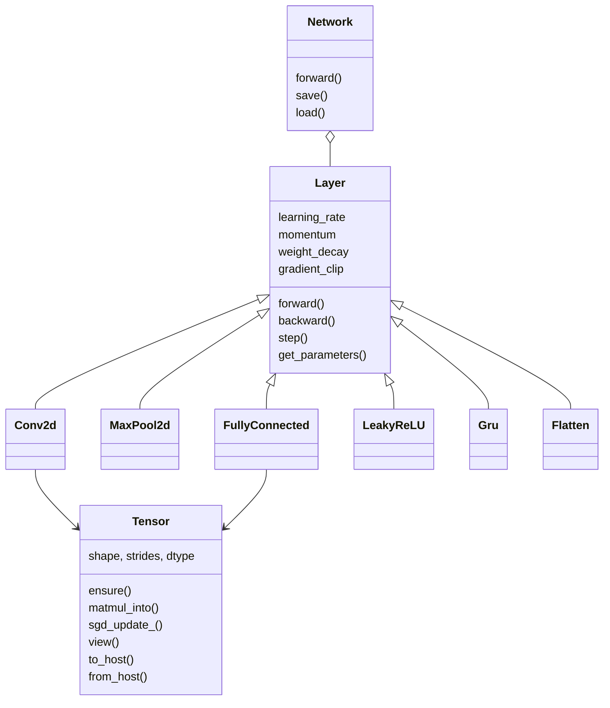

# Overview

DeepLearnLib is a C++17 / CUDA library. It allocates device memory, runs convolution, pooling, and the GRU through cuDNN, runs dense products through cuBLAS, and implements elementwise work and cross-entropy as its own kernels.

It does not build a computation graph. Each operation is a class with `forward` and `backward`. Classifier and sequence programs are assembled by applications from the layer types below. `Gru` is a reusable cuDNN layer in `layers/`.

## What is in the library

| Area | Headers | Role |
| --- | --- | --- |
| `core/` | `Tensor.hpp`, `Precision.hpp`, `Layer.hpp`, `Network.hpp`, `Batch.hpp` | Storage, the layer contract, the stack, a batch |
| `layers/` | `Conv2d.hpp`, `MaxPool2d.hpp`, `FullyConnected.hpp`, `Gru.hpp`, `LeakyReLU.hpp`, `Flatten.hpp` | Trainable and activation blocks |
| `losses/` | `Losses.hpp` | `CrossEntropyLoss` |
| `loaders/` | `ClassificationLoader.hpp`, `PackedImageLoader.hpp`, `CSVLoader.hpp`, `Ecg200Loader.hpp` | Host samples to a GPU batch |
| `utils/` | `SafeMath.hpp`, `Profiler.hpp`, `Logger.hpp`, `Nvtx.hpp`, `ParallelFor.hpp` | Numeric guards, timers, logs |

cuBLAS and cuDNN are used as the GEMM and convolution implementations. The library's own code is buffer ownership, descriptor setup, and the kernels that sit beside cuDNN and cuBLAS.

## Class diagram

Infrastructure types sit in namespace `dl`. Layers, losses, loaders, and `Network` sit in the global namespace. That split is described in [Conventions](conventions.md).

A network that wants convolution and LeakyReLU stacks those layers.

## Handles and errors

`dl::CublasContext` and `dl::CudnnContext` are process-wide. The cuBLAS workspace is allocated once. `dl::StreamGuard` sets `dl::current_stream()` for a scope and restores the previous stream on exit. `dl::bind_cudnn_stream` points the cuDNN handle at that stream.

`CHECK_CUDA`, `CHECK_CUBLAS`, and `CHECK_CUDNN` throw `std::runtime_error` with file and line. A missing cuDNN fails configuration. There is no CPU implementation of the training ops.
