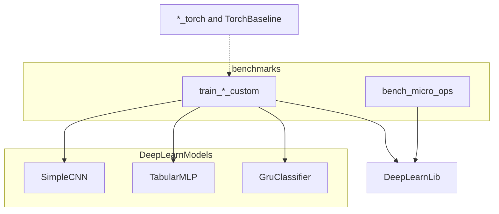

# Using DeepLearnLib

Applications live in `benchmarks/`. They construct layers, run epoch loops, and write metrics. The types they call are documented in the [library manual](../library/README.md). This manual does not repeat kernel contracts.

| Page | Subject |
| --- | --- |
| [Models](models.md) | `SimpleCNN`, the tabular MLP, and the ECG GRU |
| [Training](training.md) | What a binary does each step, and where the two CUDA streams are |
| [Experiments](experiments.md) | Pipelines, CSV columns, micro-benchmarks |
| [Measurements](measurements.md) | Thesis table copied from a local GPU run |
| [Running](running.md) | Docker, the menu, plots |

`DeepLearnModels` is a static library of the application models (`SimpleCNN`, `TabularMLP`, `GruClassifier`). Training binaries link it plus `DeepLearnLib`. The LibTorch twins live in `benchmarks/models/torch/` and are compiled only into the `*_torch` programs.

Optional `*_torch` binaries link LibTorch directly. They are the timing baseline. They are not part of `DeepLearnLib`.

Binary names are `{role}_{dataset}_{stack}`: roles `train` and `bench`; stack `custom` or `torch`. The matching JSON key is in `config/experiments.json`.
