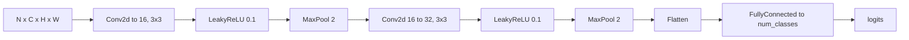
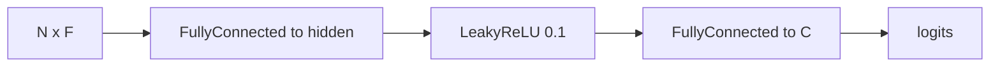

# Models

Models are ordered lists of library layers plus a `forward`. `get_all_layers()` is the list the training loop walks backward and the list `Network` saves.

Layer behaviour (fusion, GEMM, dropout) is in [Layers](../library/layers.md).

## `SimpleCNN`

`benchmarks/models/SimpleCNN.cpp`. CIFAR-10 uses it with 32×32 RGB. MNIST uses it with the spatial size and channel count stored in the packed file (28×28, 1 channel).

For 32×32 the flatten width is `32 × 8 × 8 = 2048`. The constructor computes it from `image_size`.

`forward_logits` is what training and `CrossEntropyLoss` call. The loss applies softmax itself.

## Tabular MLP

`benchmarks/models/TabularMLP.cpp`. `TorchTabularMLP` is the LibTorch twin.

`hidden_size` and `num_classes` come from the pipeline JSON. Cross-entropy reads the logits. The training program holds out `test_fraction` of the rows before the first epoch.

## GRU classifier

`benchmarks/models/GruClassifier.cpp`. One `Gru` then a `FullyConnected` on the final hidden state `[N, H]`. Input is `[N, T, F]`. `TorchGruClassifier` is a `batch_first` GRU plus `Linear`. ECG200 trains it with SGD and the momentum from the experiment file.
