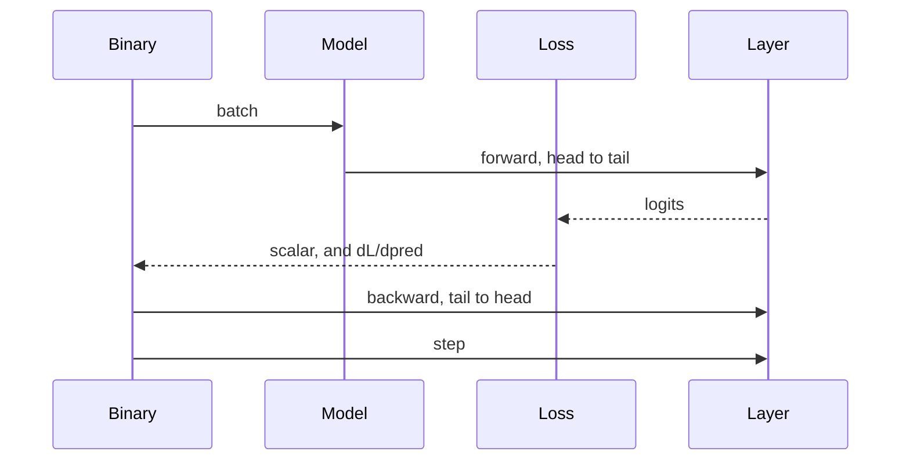
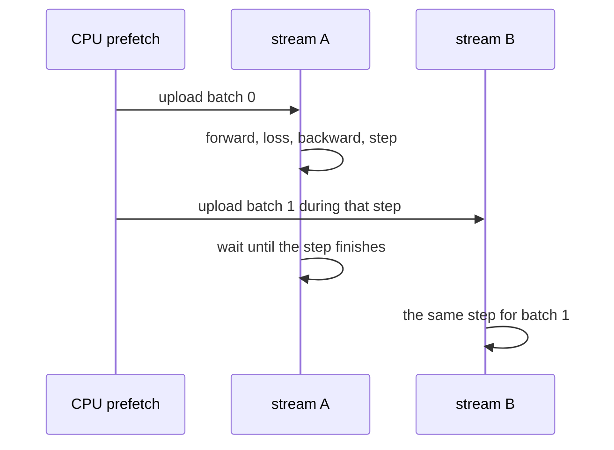

# Training loops

Every Custom training binary calls the same epoch driver. The binary owns the data and the model. The driver owns the schedule, the train pass, the test pass, and the CSV row.

Classification passes `CrossEntropyLoss` the logits and a one-hot target. The loss objects are specified in [Losses](../library/losses.md).

Before the training batches of an epoch every layer receives `train()`. Before the test pass every layer receives `eval()`. Eval does not call `backward` or `step`. Accuracy is `correct / seen` on the logits.

## Optimiser settings

At the start of an epoch the binary calls `scheduled_learning_rate` and then copies that rate onto the layers (Custom) or the LibTorch optimiser (Torch).

`lr_schedule` entries `{ "until_epoch": N, "learning_rate": r }` apply while `epoch <= N`. If the key is absent, the base `learning_rate` holds until 70% of `epochs`, then drops by 10× until 90%, then by another 10×.

`gradient_clip` from JSON is stored on the layers. `0` leaves clipping off. `step()` clamps the parameter gradient inside the update. The Torch twin clamps `.grad` once before `optimizer.step()`. The loss gradient itself is not clipped. Image and tabular runs use SGD with momentum and L2 added to the gradient, dampening 0, and Nesterov off. ECG200 uses Adam with betas 0.9 and 0.999 and epsilon 1e-8. Those are the same constants on the custom layers. Weights allocate as FP32.

Both stacks draw from seed 42. Loaders and the tabular hold-out use `portable_shuffle`. Conv and linear weights use `paired_uniform` with the same per-tensor seeds, and the Torch modules copy those values (the linear weight is transposed into Torch's `[out, in]` layout). The GRU copies the six cuDNN gate matrices into `torch::nn::GRU`. Batch-norm scale starts at 1, shift at 0, running mean at 0, and running variance at 1. Torch enables TF32 for cuDNN and cuBLAS and leaves cuDNN benchmark mode off, matching the custom math mode.

The only record of an epoch is the metrics CSV. The programs do not open a text log.

## Where the host waits

| Point | Why the binary synchronises |
| --- | --- |
| `to_host` of the loss scalar | the CSV needs a float |
| the stream that is about to be read | the upload into that buffer has finished |
| both streams at the end of the epoch | eval must observe finished updates |
| `Network::save` | the file is written from host memory |

`forward`, `backward`, and `step` only enqueue work.

## Overlapping the next batch

Loaders prefetch the next host batch inside `get_batch`. That part is library behaviour ([Loaders](../library/loaders.md)). CIFAR-10 and MNIST, on both stacks, read those same loaders. Custom training uploads the next batch on a second stream while the current step runs, then waits for that step before the next forward reads the weights.

The loop waits for an upload before it consumes that batch, and waits for the weight update before the next forward. The upload of the following batch still overlaps the current step. The callback has to enqueue forward, loss, backward, and `step` on the stream it is given.

Both stacks size the decode pool with `dl::parallel_worker_count`. The sample index comes from the sorted file list and the shared shuffle, not from whichever worker finishes first.

## Checkpoints

At the end of training the binary calls `Network::save`. The payload is the library's binary map, described in [Utilities](../library/utilities.md).
